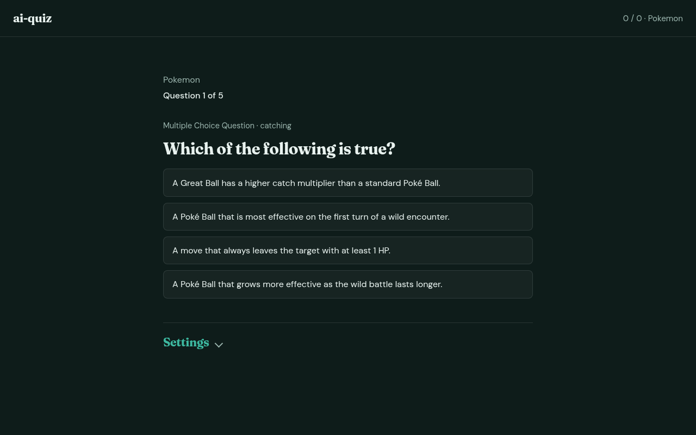
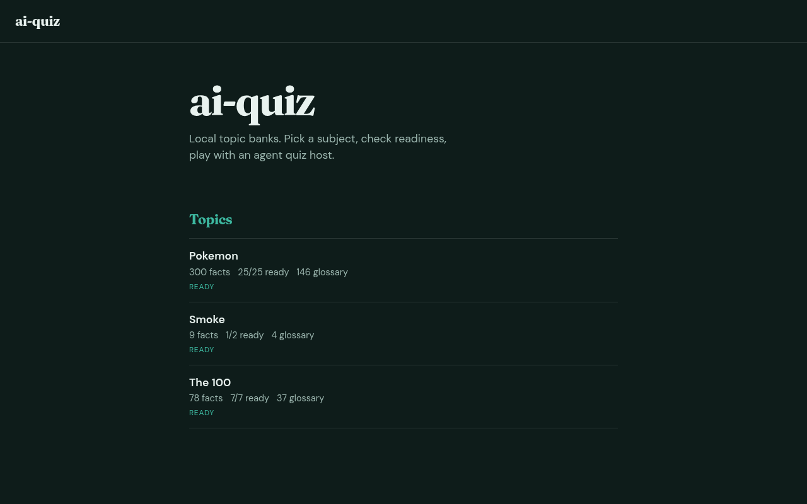
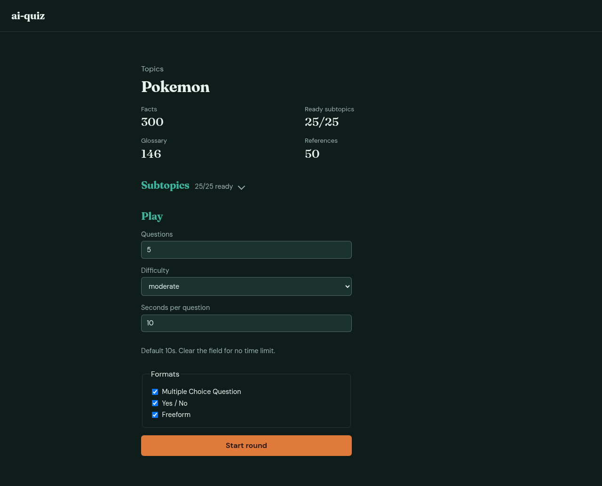

# ai-quiz

Research any subject into a local knowledge bank, then play agent-authored quizzes — in chat or in the browser.



Works with any agent harness that can run shell in this repo (Cursor, Claude Code, Codex, OpenCode, …). Contracts live in [`agents/`](agents/). Knowledge I/O is the `quiz_data` CLI; optional browser play is `quiz-web`.

## How it works

1. **Researcher agent** gathers atomic facts + a glossary ahead of time (via CLI).
2. **Quiz host** deals questions from tiny sampled slices of that bank — not the whole topic.
3. Play in an agent session, or in the local web UI with MCQ / yes-no / freeform rounds.



| Piece | Role |
| ----- | ---- |
| `quiz_data` CLI | Create topics, add facts/glossary/references, sample for a turn |
| `topics/<slug>/` | Local fact bank (gitignored) |
| `agents/` | Harness-agnostic contracts for researcher and quiz host |
| `quiz_host` | In-process host: OpenAI-compatible LLM or Cursor Agent SDK |
| `quiz-web` | Browse topics and play agent-hosted rounds |

**Difficulty:** `easy` · `moderate` · `hard` (how tightly peer glossary context stays in the same subtopic).  
**Readiness:** a subtopic needs ≥8 facts to be dealt; richer buckets also aim for ≥4 glossary terms.

Topic data stays on your machine. Agents never hand-edit those files — only `quiz_data` — so storage can change later without rewriting prompts.

More detail: [AGENTS.md](AGENTS.md), [docs/topic-format.md](docs/topic-format.md).

## Setup

Requires Python 3.11+ and [uv](https://docs.astral.sh/uv/). Licensed under [MIT](LICENSE).

With [direnv](https://direnv.net/) + Nix flakes (recommended):

```bash
direnv allow   # flake.nix → uv sync from uv.lock (web + host + dev)
```

Manual:

```bash
uv sync --extra web --extra host --group dev
# optional Cursor Agent SDK host:
# uv sync --extra web --extra host --extra cursor --group dev
```

Common tasks (optional [just](https://github.com/casey/just)):

```bash
just sync         # uv sync from lockfile
just sync-cursor  # also install cursor-sdk
just check        # ruff + pytest (same as CI)
just test
just web          # quiz-web (needs QUIZ_HOST in env)
just web-cursor   # quiz-web with QUIZ_HOST=cursor; key from `pass`
```

`just web-cursor` runs `pass show api_keys/personal/cursor_ai` for `CURSOR_API_KEY`. Override with `CURSOR_PASS_PATH=...` or `just cursor_pass=... web-cursor`.

## Web UI

Browse topic stats and play agent-authored rounds. Python samples knowledge via `quiz_data`; a pluggable `QuizHost` authors and grades each turn. Difficulty can change mid-run.

```bash
# OpenAI-compatible host (Ollama, OpenRouter, vLLM, …)
export QUIZ_HOST=llm
export QUIZ_LLM_BASE_URL=http://127.0.0.1:11434/v1
export QUIZ_LLM_MODEL=llama3.2
# export QUIZ_LLM_API_KEY=...   # if your provider needs it

# or Cursor Agent SDK host (easiest: just web-cursor)
# export QUIZ_HOST=cursor
# export CURSOR_API_KEY="$(pass show api_keys/personal/cursor_ai)"
# export QUIZ_CURSOR_MODEL=composer-2.5

just web-cursor   # http://127.0.0.1:8765
# or: quiz-web / uvicorn quiz_web.app:app --reload --port 8765
```



## CLI cheatsheet

```bash
quiz_data ensure-topic --slug pokemon --title 'Pokemon'
quiz_data ensure-subtopic --topic pokemon --slug types
quiz_data add-fact --topic pokemon --subtopic types --claim 'Pikachu is an Electric-type Pokémon.'
quiz_data add-glossary --topic pokemon --subtopic types --term 'Pikachu' --gloss 'Electric-type Mouse Pokémon'
quiz_data add-reference --topic pokemon --ref 'https://example.com'
quiz_data status --topic pokemon
quiz_data sample-for-question --topic pokemon --difficulty hard --peers 3
```

Invalid input exits non-zero with guidance on stderr.

## Copy-paste prompts

Point your agent at this repo (with `quiz_data` on `PATH`), then:

**Research**

> Research topic pokemon into the quiz bank. Create subtopics as needed. Aim for several ready buckets (≥8 facts each) with glossary terms. Use quiz_data only. Follow agents/researcher.md.

**Play**

> Topic: pokemon. Formats: mcq, freeform. Questions: 5. Difficulty: moderate. Host using agents/quiz-host.md and quiz_data sample-for-question.
